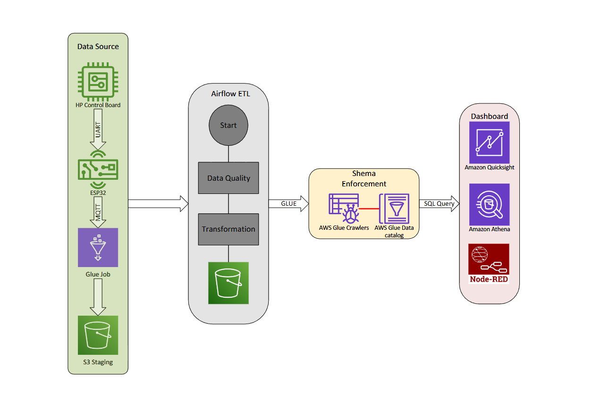
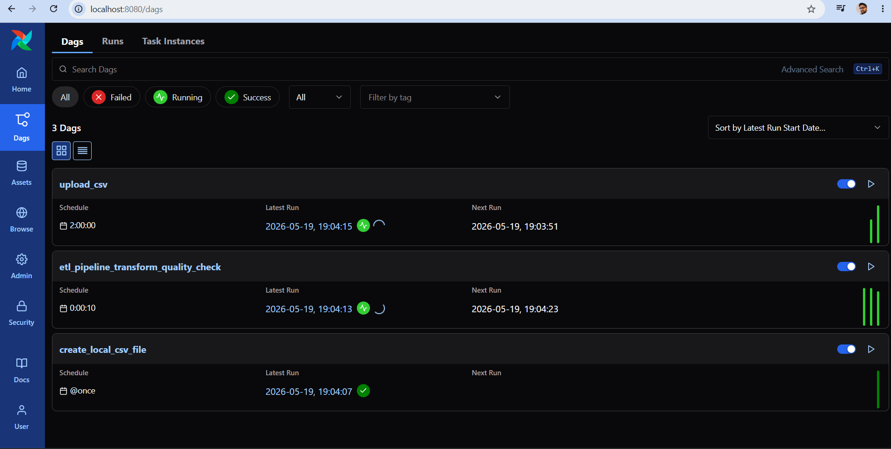
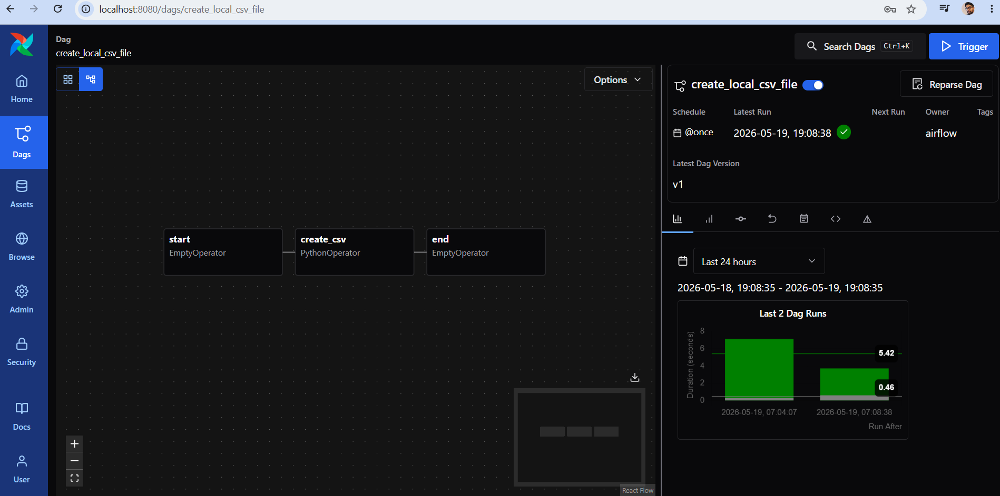
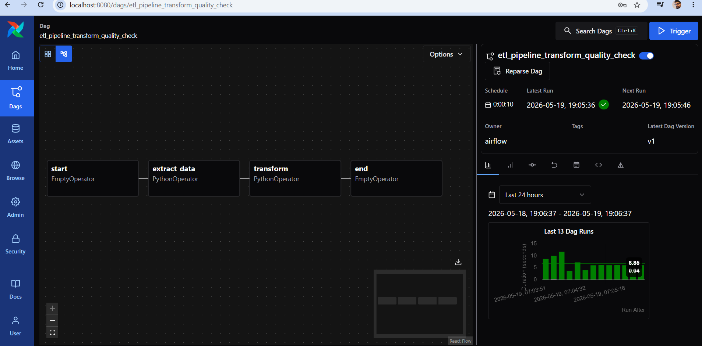
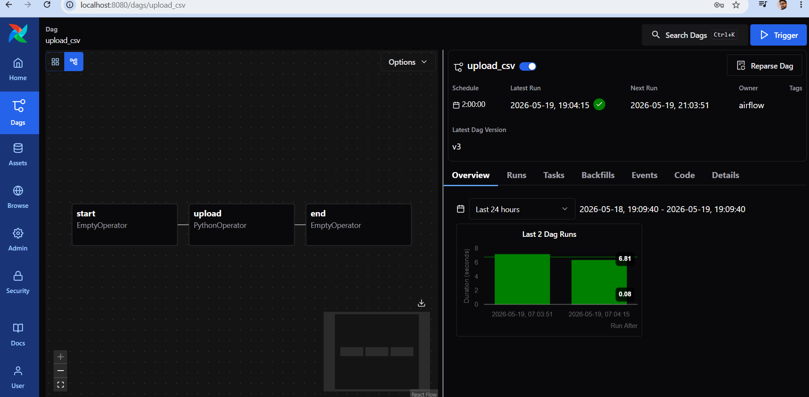

# Data Project Template

<a target="_blank" href="https://datalumina.com/">
    
</a>

## Project Organization

```
├── LICENSE            <- Open-source license if one is chosen
├── README.md          <- The top-level README for developers using this project
├── data
│   ├── external       <- Data from third party sources
│   ├── interim        <- Intermediate data that has been transformed
│   ├── processed      <- The final, canonical data sets for modeling
│   └── raw            <- The original, immutable data dump
│
├── models             <- Trained and serialized models, model predictions, or model summaries
│
├── notebooks          <- Jupyter notebooks. Naming convention is a number (for ordering),
│                         the creator's initials, and a short `-` delimited description, e.g.
│                         `1.0-jqp-initial-data-exploration`
│
├── references         <- Data dictionaries, manuals, and all other explanatory materials
│
├── reports            <- Generated analysis as HTML, PDF, LaTeX, etc.
│   └── figures        <- Generated graphics and figures to be used in reporting
│
└── src                         <- Source code for this project
    │
    ├── __init__.py             <- Makes src a Python module
    │
    ├── config.py               <- Store useful variables and configuration
    │
    ├── dataset.py              <- Scripts to download or generate data
    │
    ├── features.py             <- Code to create features for modeling
    │
    │
    ├── modeling
    │   ├── __init__.py
    │   ├── predict.py          <- Code to run model inference with trained models
    │   └── train.py            <- Code to train models
    │
    ├── plots.py                <- Code to create visualizations
    │
    └── services                <- Service classes to connect with external platforms, tools, or APIs
        └── __init__.py
```

## Sensor To Cloud Reporting System

The Sensor-to-Cloud Reporting System is an advanced IoT-based data pipeline designed to collect, store, process, and visualize real-time data from a heat pump system in a secure cloud environment. The system enables historical monitoring and analysis of key operational parameters such as temperature, pressure, pump RPM, and flow rate.

The project integrates multiple hardware sensors with an LP5536-based control system and interfaces the controller with an ESP32-based Wi-Fi data transmitter. Sensor data is securely transmitted to the cloud using the MQTT messaging protocol. Once received, the data is transformed and stored in Amazon S3 object storage as raw staging data.

An Apache Airflow-based ETL pipeline then extracts the staging data every 10 seconds, applies further transformations and data quality checks, and stores the processed data back into Amazon S3 in evry 2 hours. AWS Glue Crawlers automatically scan the processed data, generate schemas, and maintain metadata tables in the AWS Glue Data Catalog.

The curated data can then be integrated with business intelligence and visualization tools such as Microsoft Power BI or Amazon QuickSight to generate analytical dashboards and operational reports. This system provides a scalable and reliable architecture for real-time monitoring, historical analysis, and performance reporting of industrial heat pump operations.

## Key Features

1. Real-time sensor data acquisition
2. Secure sensor-to-cloud communication
3. Cloud database storage
4. Monitoring dashboard and analytical reports
5. Historical data logging and reporting
6. Remote monitoring and device management
7. Scalable architecture for multiple sensors and locations

## Project Architecture



## Dags

In this project I have 3 dags running.


# Create Local Files Dag



# Extract & Transform Dag



# Upload CSV Dag


